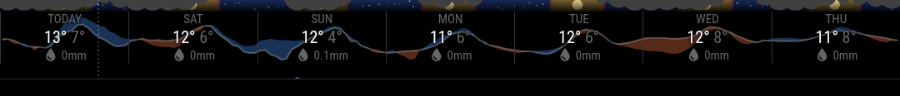
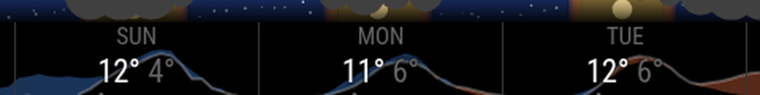

# MMM-WeatherStrip

Module for [MagicMirror²](https://github.com/MagicMirrorOrg/MagicMirror) showing the week ahead as a single row: each day's high, low and rainfall, with faint hourly charts drawn behind them. It's designed to sit in `top_bar` (or `bottom_bar`) and take up very little height.



Behind the numbers:

- **Sky** along the top: gold by day, a coral blend at dusk and dawn, deep blue with stars at night, and a pale sun at midday. Cloud cover hangs over it as solid puffs, so clear spells show sunshine or stars between them.
- **Temperature** as a line across the week, shaded blue where it's colder than the same hour the day before and red where it's warmer.
- **Rain** as hourly bars along the bottom.
- A dotted line marks **now**.



Forecast data comes from [Open-Meteo](https://open-meteo.com/), which needs no API key.

## Installing

```sh
cd ~/MagicMirror/modules
git clone https://github.com/AndyHazz/MMM-WeatherStrip.git
```

There are no npm dependencies to install.

## Config

Add it to the `modules` array in `config/config.js`. Only `lat` and `lon` are required.

```js
{
    module: "MMM-WeatherStrip",
    position: "top_bar",
    config: {
        lat: 53.8803,
        lon: -1.2773
    }
},
```

| Option | Default | Description |
|---|---|---|
| `lat`, `lon` | none | Location to forecast. **Required.** |
| `timezone` | `"auto"` | Timezone for days, sunrise and sunset. `"auto"` uses the location's own, or give an IANA name such as `"Europe/London"`. |
| `units` | your global `units` | `"metric"` (°C, mm) or `"imperial"` (°F, in) for the numbers shown. |
| `days` | `7` | Number of days to show, 1 to 15. |
| `updateInterval` | `3600000` | How often to fetch, in ms (hourly). |
| `showSky` | `true` | Sky lane along the top (day, night, stars, sun and cloud). |
| `showTemperature` | `true` | Hourly temperature line. |
| `showComparison` | `true` | Blue/red shading against the same hour the day before. |
| `showRainBars` | `true` | Hourly rain bars along the bottom. |
| `showNow` | `true` | Dotted marker at the current time. |
| `wetThreshold` | `0.5` | Daily rain (mm) below which a day's rain total is shown dimmed rather than in blue. |
| `minTempRange` | `10` | The temperature line is scaled to the week, but never stretched over less than this many °C, so a flat week looks flat. |
| `rainScaleMin` | `1` | Hourly rain (mm) that fills the rain lane, so drizzle stays small. Heavier weeks scale up to fit. |
| `cloudLane` | `14` | Height of the sky lane in px. |
| `rainLane` | `18` | Height of the rain lane in px. |
| `cloudHours` | `3` | Hours covered by each cloud puff. |
| `starSpacing` | `9` | Average gap between stars in px. |
| `twilightHours` | `0.75` | Length of the dusk and dawn blend either side of sunset and sunrise. |

`wetThreshold`, `minTempRange` and `rainScaleMin` are always in °C and mm, whichever `units` you use.

## Colours

Colours are CSS variables, so you can change them in `css/custom.css` without editing the module:

```css
.weatherstrip {
    --weatherstrip-rain: #4fc3f7;
    --weatherstrip-night: #10204a;
}
```

| Variable | Default | Used for |
|---|---|---|
| `--weatherstrip-day`, `--weatherstrip-day-opacity` | `#ffd36b`, `0.45` | Daylight |
| `--weatherstrip-twilight`, `--weatherstrip-twilight-opacity` | `#f08a5d`, `0.55` | Dusk and dawn |
| `--weatherstrip-night`, `--weatherstrip-night-opacity` | `#1d3577`, `0.75` | Night sky |
| `--weatherstrip-sun` | `#ffe9a8` | Midday sun |
| `--weatherstrip-star` | `#fff` | Stars |
| `--weatherstrip-cloud` | `#404040` | Cloud |
| `--weatherstrip-line` | `#e6e6e6` | Temperature line and now marker |
| `--weatherstrip-warmer` | `#d9663f` | Warmer than the day before |
| `--weatherstrip-colder` | `#3f7fd9` | Colder than the day before |
| `--weatherstrip-rain` | `#6cb4ff` | Rain bars and wet days' totals |
| `--weatherstrip-divider` | `#333` | Lines between days and along the bottom |

## Running it edge to edge

MagicMirror keeps a margin around the screen, so the strip normally stops short of the edges. To run it to the edges of the screen, cancel the margin for this module in `css/custom.css`:

```css
.region.top.bar .MMM-WeatherStrip {
    margin-top: calc(-1 * var(--gap-body-top));
    margin-left: calc(-1 * var(--gap-body-left));
    margin-right: calc(-1 * var(--gap-body-right));
}
```

If you've changed the body margins yourself, use your own values instead of the variables.

## Data

Weather data by [Open-Meteo.com](https://open-meteo.com/), licensed under [CC BY 4.0](https://creativecommons.org/licenses/by/4.0/). Open-Meteo is free for non-commercial use. The module makes one request an hour, well within its limits.

## Licence

MIT
